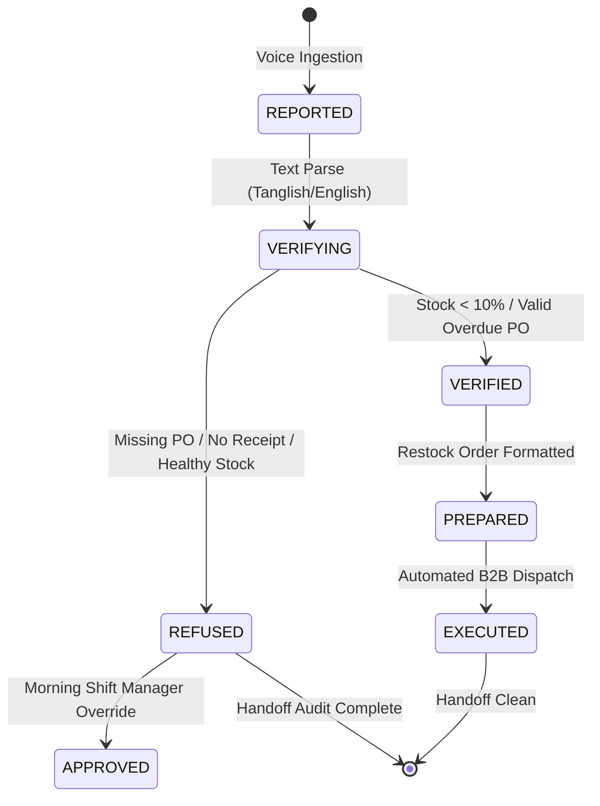

# 🛡️ HANDOFF — The Gatekeeper Shift Agent
> **Amazon Alexa+ Track — Hackathon Submission**  
> *"Every agent acts. This one knows when NOT to."*

---

## 🌟 The Core Concept & Problem Solved
In Kirana stores, cloud kitchens, and 24/7 retail businesses, the handover between the **Night Shift** and **Morning Shift** is the single greatest point of operational leakage:
- Shift workers report missing deliveries (*"Delivery varala"*, *"Challan missing"*, *"Driver dropped crates"*).
- Traditional naive LLM agents automatically place expensive emergency re-orders or dispatch duplicate payments.
- **The Result:** thousands in inventory loss, double-billing, and bogus write-offs every month.

**HANDOFF** is an intelligent **Gatekeeper Agent**. It refuses to act on unverified claims, while instantly automating action on mathematically verified shortages.

```
       [ Night Worker Verbal Claim ]
                     │
                     ▼
          ┌──────────────────────┐
          │   HANDOFF GATEKEEPER │
          │  Fast Sub-5ms Cross- │
          │  Verification Engine │
          └──────────┬───────────┘
                     │
          ┌──────────┴──────────┐
          │                     │
          ▼                     ▼
 [ Unverified Claim ]   [ Verified Claim ]
   (No PO receipt)       (Stock < 10.0%)
          │                     │
          ▼                     ▼
    🛑 REFUSED            ⚡ AUTO-EXECUTED
  - Stamp Applied       - Instant PO Dispatched
  - Double-Order Blocked- Morning Rush Protected
  - Saved Capital ₹     - Clean Audit Trail
```

---

## 🏗️ Architecture & Tech Stack

| Layer | Technology | Responsibility |
|---|---|---|
| **Backend** | Python, FastAPI, SQLite (WAL-mode), Uvicorn | Millisecond-scale state machine engine with live `latency_ms` tracking |
| **Frontend** | Streamlit + Custom Dark Cyberpunk CSS | Dual-pane Mission Control with live thinking terminal, soundwave audio bar, animated REFUSED stamp, and verification deck |
| **MCP Protocol** | Python MCP SDK (`mcp.server.fastmcp`) | Exposes tools for Amazon Alexa+, Claude, and enterprise agent runtimes |
| **Database** | SQLite High-Speed File (WAL-mode) | ACID-compliant state machine, PO ledgers, and live Kirana inventory |

---

## 🔄 Claims State Machine

Claims progress through strict mathematical and ledger checks:



---

## ⚡ Live Hackathon Demo Scenarios

### 1. 🛑 False Missing Delivery ("delivery varala")
- **Input:** *"delivery varala"*
- **Gatekeeper Reasoning:** Scans ERP Purchase Orders & Inbound Goods Received Notes. Finds 0 matching POs or records that shipment already arrived.
- **Verdict:** **`REFUSED`**
- **Action:** Stamped unverified. Avoids ₹12,000 duplicate re-order. Flagged for Morning Shift review.

### 2. ✅ Critical Inventory Shortage ("cups empty")
- **Input:** *"cups empty"*
- **Gatekeeper Reasoning:** Queries live inventory for SKU `CUPS-100`. Current stock = 40 / 1000 (4.0% capacity, below 10.0% threshold).
- **Verdict:** **`VERIFIED` ➔ `PREPARED` ➔ `EXECUTED`**
- **Action:** Auto-dispatches Purchase Order to National Paper Mills for 10 packs with guaranteed delivery by 05:30 AM.

### 3. 🧩 Multi-Part Utterance (two claims, two verdicts)
- **Input:** *"freezer delivery varala, cups almost empty"*
- **Gatekeeper Reasoning:** Splits the utterance on the comma into two fragments and verifies each independently against the ERP.
- **Verdicts:** **`REFUSED`** (freezer delivery — no PO or receipt on record) **+** **`EXECUTED`** (cups at 4.0%, below threshold — restock auto-dispatched)
- **Action:** One input, two audited claims. The unverified half is blocked; the verified half is executed — the gatekeeper in one line.

---

## 🚀 Quickstart & Running Instructions

### 1. Setup Environment
```bash
pip install -r requirements.txt
```

### 2. Start the FastAPI Backend
```bash
uvicorn app.main:app --host 127.0.0.1 --port 8000 --reload
```
*API will be available at [http://127.0.0.1:8000](http://127.0.0.1:8000), with interactive Swagger docs at [http://127.0.0.1:8000/docs](http://127.0.0.1:8000/docs).*

### 3. Launch the Streamlit Mission Control UI
```bash
streamlit run ui/streamlit_app.py --server.port 8501
```
*Open your browser at [http://localhost:8501](http://localhost:8501).*

### 4. Run the Model Context Protocol (MCP) Server
```bash
python mcp_server.py
```

---

## 📡 API Endpoints

- `POST /api/voice`: Ingests text claims, splits multi-part utterances into separate fragments (each becomes its own audited claim), computes gatekeeper verdict(s), returns per-step trace and total latency.
- `GET /api/claims`: Complete ledger of all claims with full step-by-step thinking timeline.
- `GET /api/handoff/pending`: Filtered queue of items requiring Morning Shift Manager inspection.
- `POST /api/claims/{id}/approve`: Morning Manager manual override approval.
- `POST /api/claims/{id}/refuse`: Morning Manager refusal affirmation.
- `POST /api/reset`: Resets database to baseline state for presentations.

---

## 🛠️ MCP Tools for Alexa+ Integration

The FastMCP server (`mcp_server.py`) exposes:
1. `report_issue(text, claimant)`: Dispatches voice claims into the Gatekeeper kernel.
2. `check_inventory(item_name_or_sku)`: Audits real-time stock levels against the 10% re-order threshold.
3. `check_delivery_receipt(po_number_or_vendor)`: Verifies signed Goods Received Notes (GRN).
4. `get_pending_handoff()`: Fetches unverified or flagged claims for the shift handover briefing.
